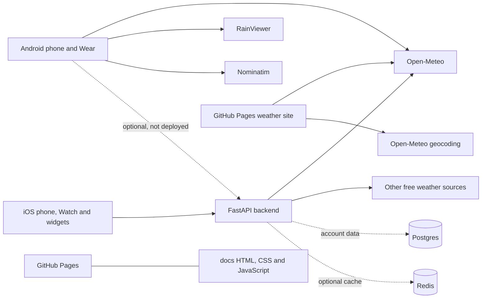

# Current architecture

This describes the repository as it is, not a future paid deployment. The full
file inventory is [CODEBASE_CATALOG.csv](CODEBASE_CATALOG.csv).

Android's basic weather path is client-direct. The multi-source consensus and
optional account/saved-location sync call the backend. Release builds currently
use `https://unconfigured.invalid/` until a real backend URL is set; those
backend features cannot work in the distributed build. Android monetization is
compiled off. Widgets and Wear consume phone-synced data and show a no-data
state before a reading exists.

iOS requests primary weather from FastAPI, and its root view currently requires
authentication. Its purchase UI is present and visible; turning off backend AI
does not remove that UI. Route paths are statically checked, but request and
response bodies and real-device flows still need integration validation. Full
Xcode and signing are needed for distribution.

FastAPI can start with no database so public weather and consensus endpoints
can work; account, favorites, and other database-backed routes then return
503. Redis is an optional cache. `ENABLE_AI_INSIGHTS` defaults to false. The
Node payment webhook service and store purchase code belong to a deferred
paid tier, not the free release.

`docs/` now contains a browser-only weather website and its legal pages. The
website calls Open-Meteo forecast and geocoding endpoints directly, with no
ClimaAI backend, user accounts, simulated data or paid API key. The existing
Pages root still serves the old legal landing page until these changes reach
the publishing branch. The old `web-demo/` prototype has been removed.
